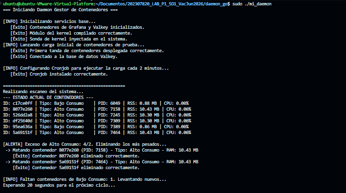
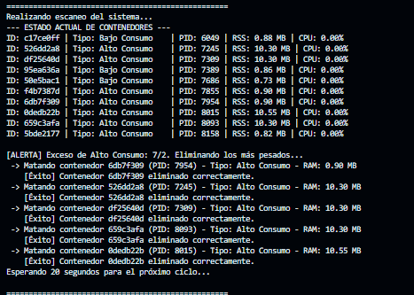
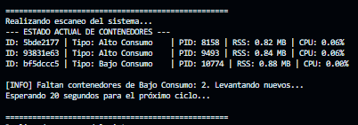
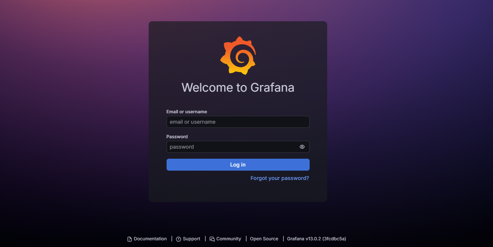
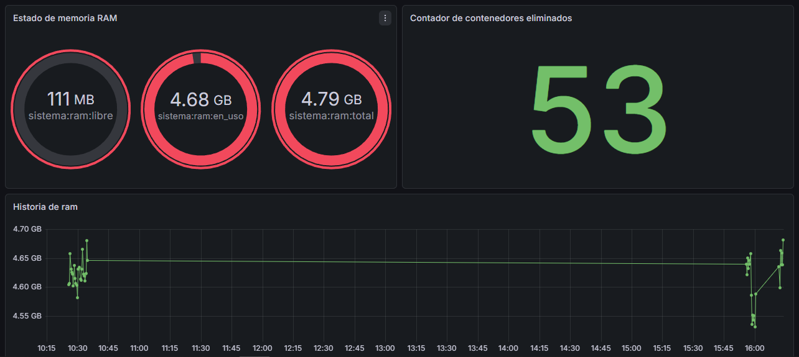
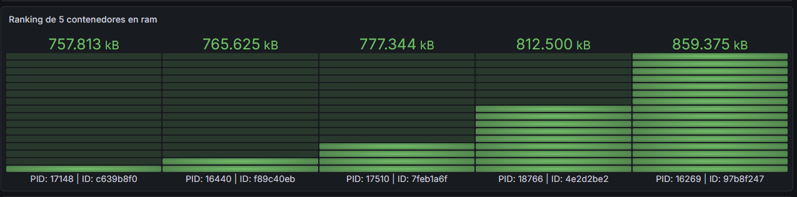
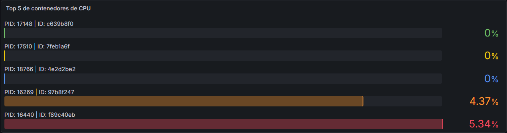
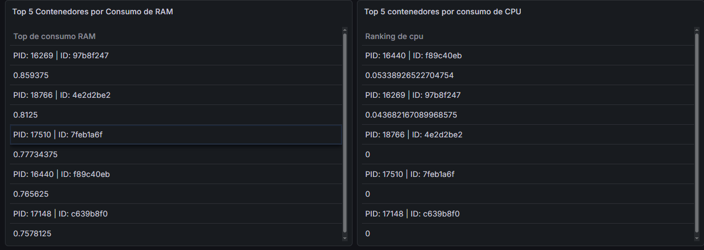

UNIVERSIDAD DE SAN CARLOS DE GUATEMALA

FACULTAD DE INGENIERÍA

MANEJO E IMPLEMENTACIÓN DE ARCHIVOS

CATEDRÁTICO: ING. SERGIO ARNALDO MENDEZ AGUILAR

TUTOR ACADÉMICO: CAMILO ERNESTO SINCAL SIPAC

======================================================================================

<div style="text-align: center;">
    <h1 style="color: white; text-decoration: underline; text-decoration-color: white;"> MANUAL USUARIO Sonda de Kernel en C y Daemon en Go para Telemetría de contenedores
</div>

=======================================================================================

<p align="right">
OTTONIEL FABRICIO VÁSQUEZ PINEDA
<br>
CARNÉ: 202307820
<br>
SECCIÓN B
</p>

<P align="center">GUATEMALA 12 DE JUNIO DEL 2026</P>

---

## 1. Introducción y Descripción General
Este sistema es una solución integral diseñada para la **monitorización proactiva, análisis automatizado y gestión inteligente de contenedores** en entornos Linux. El software opera dividiendo sus responsabilidades en el espacio del núcleo (Kernel Space) y el espacio de usuario (User Space):

1. **Sonda de Kernel (C):** Interactúa de forma nativa con las estructuras internas del sistema operativo (`task_struct`), recopilando métricas detalladas de hardware y de los procesos asociados a contenedores. Expone estos datos de manera estructurada a través del sistema de archivos `/proc`.
2. **Daemon de Control (Go):** Actúa como el cerebro del sistema. Lee y deserializa periódicamente los datos de `/proc`, toma decisiones autónomas de balance de carga (escalado y eliminación), persiste los históricos de eventos en una base de datos en memoria y orquesta el ciclo de vida del sistema.
3. **Capa de Almacenamiento y Visualización:** Utiliza **Valkey** como base de datos de alta velocidad para persistir logs y métricas temporales, y **Grafana** para renderizar páneles analíticos interactivos en tiempo real.

---

## 2. Prerrequisitos del Sistema
Para el correcto funcionamiento y despliegue del sistema, la máquina anfitriona debe cumplir con los siguientes requisitos mínimos de software y configuración:

* **Sistema Operativo:** Distribución Linux (preferiblemente Ubuntu de 64 bits con versión de Kernel 5.6 o superior).
* **Herramientas de Compilación:** Compilador GCC y utilidad `make` instalados para la construcción del módulo del kernel.
* **Entorno de Docker:** Docker Engine y Docker Compose instalados y configurados con permisos de ejecución (añadido al grupo de usuarios `docker`).
* **Lenguaje de Programación:** Go (Golang) versión 1.18 o superior para la ejecución del Daemon gestor.
* **Privilegios:** Acceso administrativo (`sudo`) indispensable para la inserción y remoción del módulo de kernel (`insmod` / `rmmod`) y la manipulación de tareas cron.

---

## 3. Arquitectura y Estructura del Proyecto
El proyecto se encuentra centralizado en un directorio raíz con la siguiente distribución jerárquica de archivos:

```text
202307820_LAB_P1_SO1_VacJun2026/
├── docker/
│   ├── docker-compose.yml       # Orquestador de Valkey y Grafana
│   └── generador.sh             # Script Cronjob de inyección de carga aleatoria
├── kernel_module/
│   ├── continfo.c               # Código fuente de la sonda de kernel en C
│   └── Makefile                 # Automatizador de compilación del módulo Kmod
└── daemon_go/
    ├── main.go                  # Punto de entrada y control de ciclos/señales
    ├── docker.go                # Abstracción y control de CLI de Docker
    ├── cron.go                  # Administrador de tareas Cron del sistema
    ├── metricas.go              # Algoritmia de conversión de RAM y cálculos de CPU
    ├── Struct.go                # Definición de tipos de datos y estructuras de mapeo
    └── valkey.go                # Driver y cliente de comunicación con la BD Valkey
```

## Guía de Instalación y Despliegue Completo

### Paso 1: Configuración de Rutas Absolutas

Antes de iniciar el sistema por primera vez, debe abrir el archivo main.go ubicado en el directorio del Daemon y validar/modificar las constantes de rutas absolutas para que coincidan exactamente con la ubicación actual de su repositorio en el disco duro:


```Go
rutaScript := "/home/ubuntu/Documentos/202307820_LAB_P1_SO1_VacJun2026/docker/generador.sh"
rutaDocker := "/home/ubuntu/Documentos/202307820_LAB_P1_SO1_VacJun2026/docker"
rutaKernel := "/home/ubuntu/Documentos/202307820_LAB_P1_SO1_VacJun2026/kernel_module"
```

### Paso 2: Ejecución del Daemon

Abra una terminal en la raíz del código fuente de Go (daemon_go/) y ejecute el comando de inicialización con privilegios elevados de superusuario:

```bash
sudo ./mi_daemon
```

Al ejecutarse, el Daemon realizará de forma secuencial y automatizada las siguientes tareas de infraestructura:

1. Levantará los contenedores de infraestructura base (Valkey y Grafana) mediante Docker Compose.

2. Compilará el código de la sonda de kernel en C (continfo.c) generando el binario modular .ko.

3. Inyectará la sonda directamente en el núcleo del sistema operativo de forma transparente.

4. Desplegará la primera tanda de contenedores simulados y se conectará con éxito a la base de datos de telemetría.

5. Registrará e instalará de forma nativa la tarea programada (Cronjob) en el sistema.



## 5. Funcionamiento del Sistema en Tiempo Real

Una vez superada la fase de inicialización, el Daemon entrará en un ciclo infinito de procesamiento que se repite automáticamente en intervalos de 20 segundos. Durante cada ciclo, el sistema ejecutará un escaneo completo y reportará las actividades en la consola.


### Monitoreo y Gestión Automatizada de Recursos
El software mantiene un control estricto sobre el ecosistema de contenedores de prueba bajo una regla analítica de umbrales fijos:

- Contenedores de Bajo Consumo: Debe haber exactamente 3 activos en todo momento.

- Contenedores de Alto Consumo: Debe haber exactamente 2 activos en todo momento.

### Escenario A: Exceso de Carga (Simulación por Cronjob)
Cada 2 minutos, el Cronjob del sistema operativo ejecutará de forma silenciosa el script ```generador.sh```, el cual inyectará de golpe 5 nuevos contenedores seleccionados de manera aleatoria entre perfiles de alta carga de RAM, alta carga de CPU o bajo consumo.

En el siguiente ciclo de 20 segundos del Daemon, la sonda detectará un exceso sobre el límite máximo. El software ordenará inmediatamente a los contenedores de ese tipo por peso (de mayor a menor consumo de recursos) y procederá a eliminar los contenedores más pesados de forma consecutiva hasta estabilizar el entorno nuevamente al número exacto permitido.



### Escenario B: Déficit de Carga
Si por algún motivo externo (caída del contenedor, terminación manual o desbalance en el algoritmo aleatorio del generador) el conteo de contenedores cae por debajo del mínimo obligatorio (3 de bajo consumo o 2 de alto consumo), el Daemon actuará proactivamente levantando y desplegando los contenedores faltantes en ese mismo instante, garantizando la continuidad de las métricas.



## 6. Visualización de Métricas en Grafana
El sistema cuenta con un entorno visual centralizado y preconfigurado para el análisis de rendimiento histórico.

### Acceso a la Plataforma
1. Abra el navegador web de su preferencia en la máquina anfitriona o red local.

2. Diríjase a la siguiente dirección URL: ```http://localhost:3000```

3. En la pantalla de inicio de sesión de Grafana, introduzca las credenciales por defecto configuradas en el entorno:

    - Usuario: admin

    - Contraseña: admin




### Componentes del Dashboard Analítico
Una vez dentro, podrá acceder al Dashboard de Telemetría del Proyecto, el cual extrae dinámicamente los datos almacenados por el Daemon dentro de la base de datos Valkey. El tablero se compone de los siguientes elementos visuales obligatorios:

1. Visión General del Sistema (Tarjetas/Cards):

    - Total de RAM: Muestra la capacidad física total instalada en el servidor en tiempo real.

    - RAM Usada: Indica el consumo actual de memoria del sistema operativo completo en megabytes.

    - Memoria Libre: Indica el remanente disponible de memoria RAM sin asignar.

2. Evolución Temporal (Gráficos de Líneas / Time Series):

    - Uso de RAM a lo largo del tiempo: Una gráfica lineal continua con marcas de tiempo (timestamps) en el eje X que refleja las fluctuaciones de consumo del servidor.

    - Contenedores Eliminados a lo largo del tiempo: Gráfico de barras o líneas temporales que registra cuántas unidades destructivas ejecutó el Daemon ante los picos de estrés provocados por el cronjob.

3. Top Rankings de Consumo Histórico (Gráficos de Pastel / Pie Charts):

    - Top 5 Contenedores por Consumo de RAM: Distribución porcentual que identifica a los contenedores más demandantes de memoria por su PID y ID único, incluyendo históricos que ya fueron eliminados.

    - Top 5 Contenedores por Consumo de CPU: Gráfico que resalta los hilos de ejecución de Docker con mayores picos de procesamiento matemático en el microprocesador.







